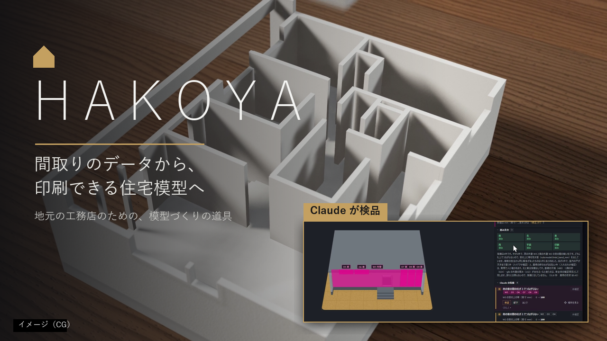
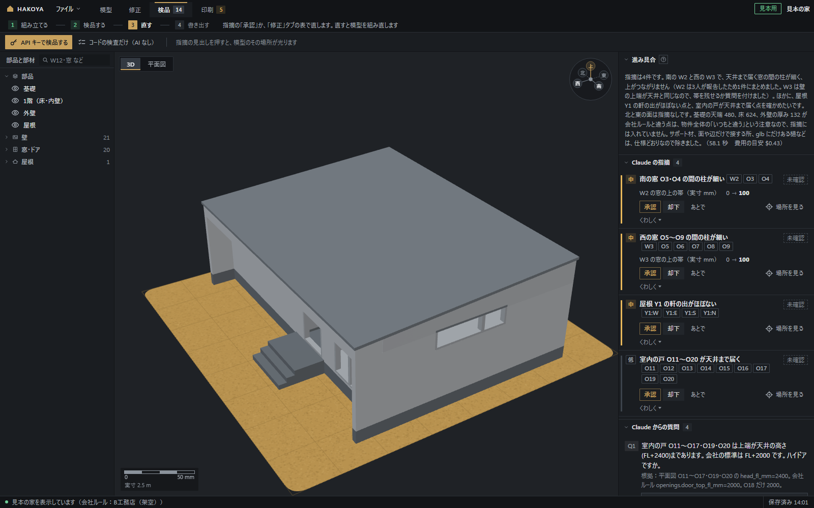

# HAKOYA

**間取りのデータから、印刷できる住宅模型へ。地元の工務店のための、模型づくりの道具です。**



**Built with Claude: Japan 2026 への提出作品です。**

- 紹介動画（3分）：https://youtu.be/pmJCGsj-ys8
- 使い方（利用マニュアル）：[docs/manual.md](docs/manual.md)
- 作りの説明（設計書）：[docs/design.md](docs/design.md)
- 仕様書（詳しい決まり）：[SPEC.md](SPEC.md)
- 自分の Claude Code からつなぐ（MCP）：[docs/mcp.md](docs/mcp.md)

Walk in home（住宅の提案に使う営業用 CAD）の 3D データ（glb）を読み込むだけで、**1/50 の住宅模型の 3D プリント用データ（3MF）**を作る Windows のソフトです。
形の計算はコード（Python）、模型の検品と直す案は Claude が受け持ちます。

## なぜ作ったか
作者は、注文住宅を建てる地元の工務店に勤めています。金利の上昇と建築費の高騰で、家を建てるお客様は業界全体で減っています。

お客様が家を建てる会社を考えるとき、選択肢は大きく2つです。地元の中小工務店と、大手ハウスメーカー。工務店の強みは、地域に寄り添い、お客様との距離が近いこと。弱みは、家の完成度が会社や職人によって違うことです。ハウスメーカーには、体系化された営業と家づくり、そしてブランドがあります。お客様は最後に、どの会社に「ワクワク」できるか、「安心」できるかで決めるのだと思います。

作者は、地元の工務店が頑張り、地域を盛り上げることを願っています。AI でハウスメーカーに並ぶ方法を考え、営業の道具・打ち合わせの議事録・工程の管理なども検討しました。ただ、建築の仕事は人や会社によって進め方が大きく違います。そこで、どの会社にもある「プラン提案」の場で、**提案の幅を広げる**ことにしました。

プラン提案で模型を見せられれば、お客様は平面図だけでは分からない家のバランスや、住んだときの暮らしを思い描けます（ワクワク）。「模型で言うとこの部分です。この作りで耐久性を高めています」と、こだわりも伝わります（安心）。

ただ、模型を誰が作るかが問題です。外注すれば1つ数万円（作者の会社でも、見学会の模型を外注しました）、社内で作れば10〜30時間。3D プリンターで作るには Blender などで 3D モデルを作る必要があり、作者も本を買って10時間学びましたが、挫折しました。受注できるか分からない提案のたびに模型を作るのは、時間も費用も見合いません。

HAKOYA は、この「模型を作る」所を、ふだんの営業用 CAD のデータを読み込むだけにします。住宅の仕事をする人なら、経験を問わず使えることを目指しました。プランが変われば、すぐに印刷し直せます。引き渡しのときに、色を塗った模型を贈る使い方もできます。地域の家を、地域の工務店が守っていくための道具です。

## こんな人に
- 地元の工務店で、プラン提案に模型を使いたいが、外注の費用や作る時間が見合わない。
- 3D の知識はないが、ふだん Walk in home で間取りを作っている。
- 3D プリンターはある（または入れたい）が、Blender などで模型を作るのは難しかった。
- 「地元の工務店とハウスメーカーのどちらでもいい」というお客様に、ワクワクと安心を、形にして見せたい。

## 何ができるか


1. **読み込んで組み立てる**：glb から壁・窓とドア・屋根・基礎を作り直し、基礎・1階・屋根などに分かれた模型の部品にします。屋根を外すと、中の間取りまで見えます。
2. **Claude の検品**：Claude が東・西・南・北・平面・印刷の6つの面を見比べて、食い違いを根拠つきで挙げます。指摘を押すと、模型と平面図のその場所が光ります。直す案は「承認」で反映され、分からない所は Claude が質問してきます（答えると、次の検品に生かされます）。
3. **直す**：
   - 表で数値を直す（AI なし）。
   - 3D で部材を押すと、光って名前が出ます。そのまま「文字で直す」に一言で頼めます（例：「南の軒の出を 600mm にして」）。
   - 平面図や 3D で囲んで一言で頼むこともできます（いくつも囲めます）。
   - 承認すると組み直して、右下に知らせます。直した内容は履歴に残り、取り消せます。形が変わらなかった直しは、自動で取り消して知らせます。
4. **分けて印刷する**：プリンターに入らない長い家は、内壁の面で自動で分けます（窓や壁の途中は避けます）。分け目は平面図でドラッグして動かせます。
5. **書き出す**：3MF（Bambu Studio 形式）・STL・GLB。印刷タブの「外壁の仕上げ」で、外壁だけをざらざらとしたテクスチャー（ファジースキン）にするかを、物件ごとに選べます（塗り壁の演出に。既定は会社ルールのとおりで、見本の B工務店（架空）はサイディングなので付けません）。
6. **会社ルール**：壁の厚みや軒の出などの会社の決まりは、数値（`rules/<会社>.yaml`）と判断の仕方（`skills/company-<会社>/SKILL.md`）に分けて持ち、差し替えられます。家が何棟もたまると、「会社ルール」のタブで、コードの集計と Claude の案から決まりを学べます（人が承認したものだけを使います）。

## まず試す（見本の家・5分）
1. このリポジトリを手元に置き、部品を入れます（下の「動かし方」）。
2. `start_sample.bat` をダブルクリックします。ブラウザで HAKOYA が開き、**見本の家（動画に出てくる家）が最初から入っています**。見本の家は、作者が Walk in home で作った架空の家です（お客様の家ではありません）。
3. 「検品」のタブで、Claude の検品の結果を見られます。指摘の見出しを押すと模型が光り、「承認」で直して組み直します（ここまで API キーは要りません）。
4. 「模型」のタブで「パーツを離す」と、基礎・1階・屋根が分かれます。「印刷」のタブで 3MF を保存できます。

## しくみ
```
営業用 CAD の glb ─▶ 読み込み（adapters/）─▶ 組み立て・検査（core/）─▶ 3MF・STL・GLB
                                                  ▲          │ 6つの面の絵・検査の結果
                     直す案（どの部材を・どう直すか）│          ▼
                                          Claude（検品・直す案。HAKOYA の道具だけを使う）
画面：FastAPI ＋ three.js（app/）    自分の Claude Code からは MCP で同じ道具を使える
```
- **数値（座標・寸法・高さ）は、すべてコードが計算します。** Claude が返すのは「どの部材の・どの値を・何に合わせて直すか」と、数値の出どころ（会社ルール・図面・人の一言）だけです。
- 形をつくるのはコードなので、AI を使うのは検品と直す案だけです。1棟の AI の費用は、API キーで百円ほどです（検品1回 約 $0.4 ＋ 直す案を数回。11/6 の実測の目安）。
- 検品は、面ごとの担当（Claude のサブエージェント）が同時に見比べ、まとめ役がひとつにまとめます。

## 起動のしかた（3つ。データも別々）
画面の中では切り替えず、起動のしかたで分けています（3つ同時に開けます）。
- **`start.bat`**：自社用。会社ルールは、見本の B工務店（架空）です。「会社ルール」のタブ（直した記録の集計・Claude の案・学んだルール）も使えます。
- **`start_other.bat`**：他社用（ほかの工務店に配る版の形。データは `data\other\`）。AI のつなぎ方は API キーと AI なしで、「会社ルール」のタブはありません。
- **`start_sample.bat`**：見本用。押すと、**見本の家（動画に出てくる家）が最初から入っています**。組み立てた模型と、Claude の検品の結果（指摘を押すと模型のその場所が光る・承認で直す）まで、すぐに試せます。
- このフォルダを別の場所に動かしたあと、見本の家が開けなくなったら、このフォルダの中の `data\sample` を消してください。次に `start_sample.bat` を押したときに、見本の家を写し直します。

## AI のつなぎ方（3通り）
- **API キー**：自分の Claude の API キーを「ファイル」→「環境設定」で入れます。料金は使った分だけです。
- **自分の Claude Code から（MCP）**：自分の Claude Code に HAKOYA の道具をつないで、自分のプランの中で検品や直しを頼みます（下の「自分の Claude Code から使う」）。
- **AI なし**：組み立て・表で直す・3MF の書き出しまで、AI なしでできます。
- アプリの中から Claude のプラン（ログイン）でつなぐ方法は、公開の版には入れていません（Anthropic の決まりで、アプリの作り手は、ほかの人に Claude のプランのログインを使わせてはいけないため）。

## 使い方
- 左上の「ファイル」→「新しく読み込む…」で、手元の Walk in home の glb（2024 版で確認）を仮名（例：物件A）で登録すると、組み立てて開きます。元のファイルは読むだけです。
- 作業はタブで分かれています：模型（見る・パーツを離す）・修正（表で直す・囲んで直す・文字で直す・直しの履歴）・検品（Claude の検品）・印刷（書き出し・分け目）・会社ルール（自社用）。
- 直した内容は自動で保存されます。「ファイル」→「過去の物件を開く…」で、前の物件を開けます。

## 自分の Claude Code から使う（MCP）
HAKOYA の道具（物件を見る・組み立て・6つの面の絵・検査・直す案・承認・書き出し）を、自分の Claude Code につなげます。つなぎ方と、データのフォルダを読ませない設定の例は [docs/mcp.md](docs/mcp.md) にあります。

## 動かし方（Windows）
Windows 11（作者が確かめた環境。Windows 10 は未確認）、Python 3.11 以上と git が要ります。Bambu Studio 形式の 3MF を作るときは、Bambu Studio も入れてください（なくても、ふつうの 3MF・STL は作れます）。PowerShell で：

1. このリポジトリをダウンロードして、そのフォルダに移動する
   ```powershell
   git clone https://github.com/akamatsu6938/hakoya.git hakoya
   cd hakoya
   ```
2. 仮想環境（このソフト専用の Python の置き場）を作り、部品（ライブラリ）を入れる
   ```powershell
   python -m venv .venv
   .\.venv\Scripts\python -m pip install -e ".[dev]"
   ```
3. `start_sample.bat`（見本の家ですぐ試す）か `start.bat`（自分の glb を読み込む）をダブルクリックする。ブラウザで HAKOYA の画面が開きます（止めるときは黒い画面で Ctrl+C）。
4. （確かめたいとき）テストを走らせる
   ```powershell
   $env:PYTHONUTF8 = "1"
   .\.venv\Scripts\python -m pytest -q
   ```
   実データ（お客様の家）と、公開していない自社の決まりを使うテストは飛ばされます（skip と出ます）。

## フォルダの中身
| フォルダ | 中身 |
|---|---|
| `app/` | 画面（FastAPI のサーバーと、three.js の 3D・平面図）と、MCP のサーバー |
| `adapters/` | Walk in home の glb を読み、壁・窓・屋根・基礎を作り直す |
| `core/` | 模型の組み立て・検査・書き出し・分割・個人情報の見張り、Claude の検品と直す案（`core/ai/`） |
| `rules/`・`skills/` | 会社ルール（数値の yaml と、判断の仕方の Skill）。見本の B工務店（架空） |
| `samples/sample_house/` | 見本の家（glb と、組み立て・検品の結果）と、この README の絵 |
| `tests/` | テスト（pytest） |
| `tools/` | 平面図の絵・まとめて検査・印刷の見込みなどの道具 |
| `docs/` | 利用マニュアル（manual.md）・設計書（design.md）・MCP のつなぎ方・開発の記録・決めたこと・失敗の記録 |

## B工務店（架空）で試す
- このリポジトリに入っている会社の決まりは、見本の **B工務店（架空）** だけです（`rules/bkoumuten.yaml`・`skills/company-bkoumuten/`）。値はどれも架空です。起動すると、これが最初から選ばれています。
- 入っている家の glb は、見本の家の1つだけです（`samples/sample_house/`。組み立てと検品の結果も入っています）。作者が Walk in home で作った架空の家で、Walk in home の素材の画像と、家具・設備の商品名は抜いてあります（形は同じです）。お客様の家の glb・図面は入っていません。
- 自分の会社の決まりを作るときは、`rules/bkoumuten.yaml` と `skills/company-bkoumuten/` を写して、名前と値を変えます（項目はすべてそろえてください。足りないと組み立ての途中で止まります）。
- 会社ルールの学習（「会社ルール」のタブ）は、家が何棟もあるときに使えます（何棟分もの直した記録から、決まりの案を作るため）。

## まだできないこと
- 確かめたのは Walk in home（2024 版）の glb だけです。ほかの CAD のデータは読めません。
- 3階建てはまだ扱えません（2階建てまで。組み立ての途中で、日本語の説明を出して止まります）。
- 実際の家14棟で確かめましたが、すべての家の形に合うとは限りません。Claude の検品は、見落としを減らすための手助けで、最後に確かめるのは人です。
- 見本の家のほかに検品するには、API キーか、自分の Claude Code（MCP）が要ります。
- 配るための exe は、このリポジトリには入れていません（`packaging/` に作り方の設定があります）。
- 実物の印刷は、まだしていません。はめあいの隙間・ずれ止めの大きさ・ざらざらの強さは、試し印刷で決める予定の仮の値です。印刷の時間と材料は、スライスの見込みです（見本の家で3回の印刷・約12時間・約400g。推定）。

## 自社の決まりは公開していません
最初の利用者の工務店の決まり（数値の yaml と、判断の仕方の Skill）は、このリポジトリに入れていません。
仕様書（SPEC.md）の §5-1・§5-2 も、同じ理由で本文を省いています。見本は B工務店（架空）です。

## 作った期間と、使っている部品
- Built with Claude: Japan 2026（2026-11-02 12:00 の開始から 11-08 20:00 まで）の間に、このリポジトリのコードを全部新しく書いています。
- 使っている外の部品（ライセンスはそれぞれのもの）：three.js（画面の 3D。`app/static/vendor/three/`）・FastAPI・trimesh・shapely・manifold3d・ezjww・pdfplumber・Claude Agent SDK・Anthropic の SDK など（全部は `pyproject.toml`）。ありがとうございます。

## Claude Code での作り方
開発は、Claude Code と6日間で行いました（2026-11-02〜11-07）。
- 大きな直しは、Claude Code のサブエージェントに分けて同時に作り、見直し役のサブエージェントが不具合を探しました。
- フックで、元のファイルへの書き込みと、お客様の名前がコミットに入ることを止めています。
- 実際の家14棟（お客様の家なので、リポジトリには入れていません）で、形が崩れないことをまとめて確かめながら作りました。

## 履歴について
このリポジトリは、提出のために開発のリポジトリから作り直したものです。開発の主な流れのコミットを、元の日時・作者のまま積み直しています（別の枝で進めた作業は、合流のコミットにまとめています）。
ただし、公開しないもの（自社の会社ルール・作業のメモ・人や会社を特定できる言葉）は、すべてのコミットとメッセージから抜くか置きかえています。そのため、古いコミットの中身は開発のときと少し違います。README は最後のコミットで提出用に差し替えています。
開発の流れは、次の記録でも見られます。
- [docs/devlog.md](docs/devlog.md)：日ごとに作ったもの・使った Claude Code の機能・詰まったことと解き方
- [docs/claude-usage.md](docs/claude-usage.md)：Claude Code がなかったらできなかったこと、アプリの中で Claude がしていること
- [docs/decisions.md](docs/decisions.md)（技術を選んだ理由）・[docs/mistakes/](docs/mistakes/)（失敗の記録と予防）

## 守っていること
- 元の glb・図面には書き込みません。お客様の家（`data/` の実データ）はリポジトリに入れていません。入っている家は、見本の家（`samples/sample_house/`）だけです。
- 施主名・住所などは、画面・出力・ログに出しません。図面の画像を Claude に送るときは表題欄を切り落とします。
- API キーはコード・設定ファイル・exe に入れません。使う人が「ファイル」→「環境設定」で入れ、Windows の資格情報マネージャーに保存します。
- ライセンスはまだ付けていません。
