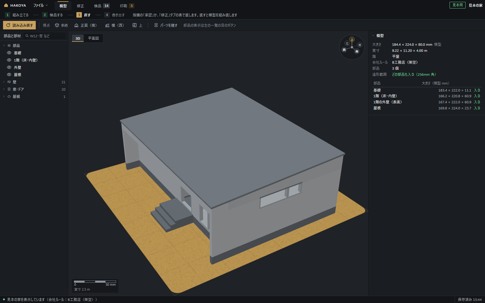
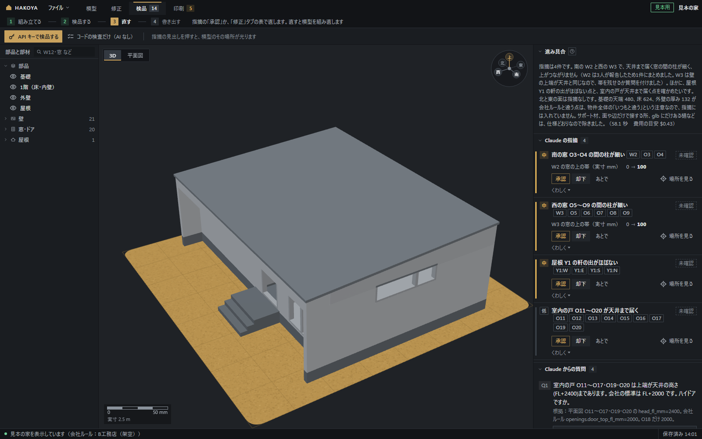
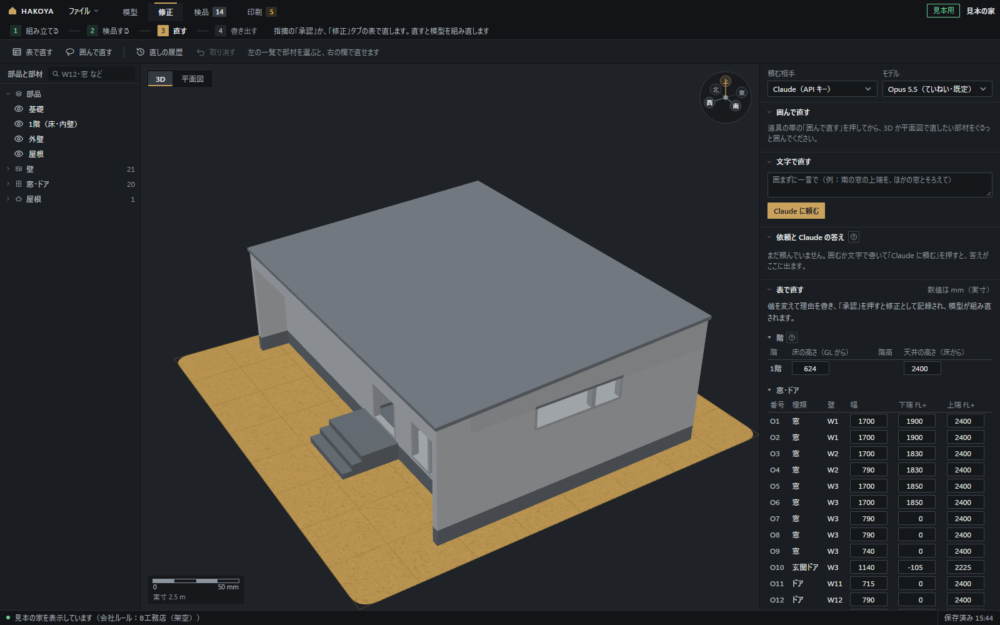
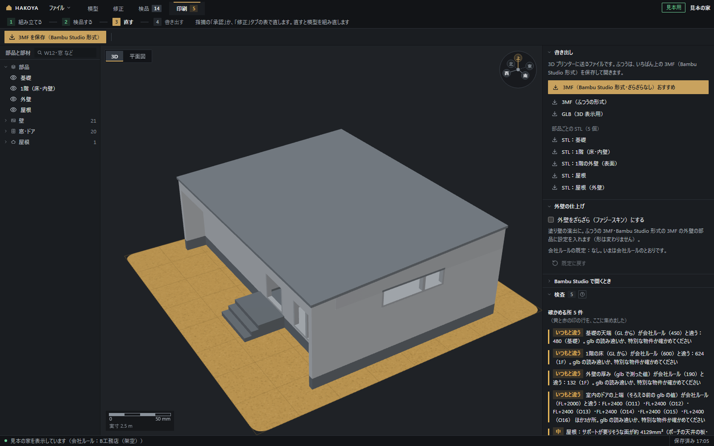
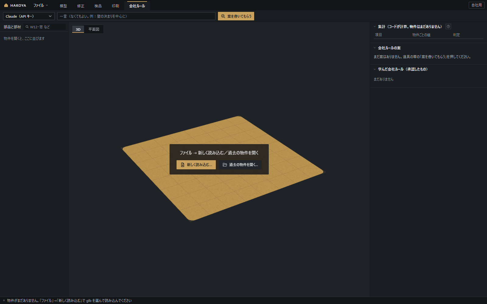

# HAKOYA 利用マニュアル（使い方）

HAKOYA（箱家）を、**入れる所から 3D プリントまで**、この文書だけで進められるように書いた説明書です。
パソコンに慣れていない人でも、上から順に読んで手を動かせば使えるようにしています。

- 作りの説明は [設計書（docs/design.md）](design.md)、細かい仕様は [SPEC.md](../SPEC.md) にあります。
- 「(推定)」は作者の記録からの見込み、「(要確認)」はまだ確かめていない所です。
- 画面の絵は `samples/sample_house/screens/` にあります（絵がまだない所もあります）。

---

## 目次

1. [HAKOYA でできること](#1-hakoya-でできること)
2. [ことばの説明（用語集）](#2-ことばの説明用語集)
3. [要るもの](#3-要るもの)
4. [準備：ゼロから入れる](#4-準備ゼロから入れる)
5. [3つの起動のしかた](#5-3つの起動のしかた)
6. [見本の家で一周する](#6-見本の家で一周する)
7. [画面の見方](#7-画面の見方)
8. [自分の家を読み込む](#8-自分の家を読み込む)
9. [模型タブ：見る](#9-模型タブ見る)
10. [検品タブ：Claude とコードが調べる](#10-検品タブclaude-とコードが調べる)
11. [修正タブ：自分で直す](#11-修正タブ自分で直す)
12. [印刷タブ：書き出す](#12-印刷タブ書き出す)
13. [3D プリントまで（Bambu Studio）](#13-3d-プリントまでbambu-studio)
14. [会社ルールタブ（自社用だけ）](#14-会社ルールタブ自社用だけ)
15. [AI のつなぎ方と API キー](#15-ai-のつなぎ方と-api-キー)
16. [困ったとき（よくある質問）](#16-困ったときよくある質問)
17. [まだできないこと・確かめていないこと](#17-まだできないこと確かめていないこと)

---

## 1. HAKOYA でできること

- 間取りソフト Walk in home の 3D データ（glb）を読み、**1/50 の住宅模型の 3D プリント用データ（3MF）**を作ります。
- 壁・窓とドア・屋根・基礎を作り直し、基礎・1階・（2階）・屋根に分かれた部品にします。屋根を外すと中の壁まで見えます。
- Claude が模型を元の形と見比べて食い違いを挙げ（検品）、人が「承認」すると直ります。**AI なしでも 3MF まで作れます。**

## 2. ことばの説明（用語集）

| ことば | 意味 |
|---|---|
| glb（ジーエルビー） | 3D の形を1つにまとめたファイル。Walk in home が書き出す家の 3D データ |
| 3MF（スリーエムエフ） | 3D プリンター用のファイル。部品ごとの設定も入れられる。HAKOYA のいちばんの出力 |
| STL（エスティーエル） | 3D プリンター用の、形だけのファイル。部品ごとに1つずつ |
| GLB（書き出し） | HAKOYA が作った模型を、ほかの 3D のソフトで見るためのファイル |
| スライサー | 3D のデータを、プリンターが動ける命令（層ごとの道すじ）に変えるソフト |
| Bambu Studio（バンブースタジオ） | Bambu Lab のプリンター用のスライサー。無料 |
| ファジースキン | 印刷のときに外壁の線を細かく揺らす Bambu Studio の機能。外壁がざらざらになり、塗り壁の感じが出る |
| 造形範囲 | プリンターが一度に作れる大きさ。Bambu Lab A1 は 256mm 角（HAKOYA は縁の余白を引いて 246mm で見る） |
| 1/50 | 模型の縮尺。実物の 50 分の 1（実寸 5,000mm → 模型 100mm） |
| GL・FL | GL＝地面の高さ。FL＝床の高さ。「FL+2000」は床から 2,000mm |
| 部材の番号 | HAKOYA が部材に付ける番号。W＝壁、O＝窓・ドア、Y＝屋根（例：W12・O3・Y1）。「Y1:S」は屋根 Y1 の南の軒 |
| 仮名 | 物件の呼び名（例：物件A）。お客様の名前の代わりに、画面とファイルではこれを使う |
| 出してはいけない言葉 | 施主名・住所など。HAKOYA は画面・ファイル・Claude に送る文に、これが入らないように見張る |
| 検品 | 組み立てた模型を、元の形（glb）と見比べて、おかしな所を探すこと |
| 指摘 | 検品で見つかった「おかしいかもしれない所」。見出し・理由・対象の部材が付く |
| 直す案 | 「どの部材の・どの値を・何に合わせて直すか」。数値はコードが計算する |
| 承認・却下・あとで | 人が決めること。承認＝そのとおり直す、却下＝直さない、あとで＝まだ決めない |
| 修正（直し） | 人が承認した直し。1件ずつ記録され、いつでも取り消せる |
| 会社ルール | 会社ごとの決まり（壁の厚み・基礎の高さなど）。見本は B工務店（架空） |
| API キー | Claude を自分のお金で使うための合い言葉の文字。人に見せてはいけない |
| Claude Code | Anthropic の、パソコンで Claude と作業する道具 |
| MCP | Claude Code に、ほかのソフト（ここでは HAKOYA）の道具をつなぐしくみ |
| 仮想環境（.venv） | HAKOYA 専用の Python の置き場。ほかのソフトとまざらない |
| PowerShell | Windows に入っている、文字で命令を打つ画面 |
| 口の番号 | ブラウザで開くアドレスの番号（例：`http://127.0.0.1:8765/` の 8765） |

## 3. 要るもの

| もの | 説明 |
|---|---|
| Windows 10 / 11 | 作者が使っているのは Windows 11 です（Windows 10 は (要確認)） |
| Python 3.11 以上 | HAKOYA を動かす道具（4-1）。作者は Python 3.14 で使っています |
| git | リポジトリ（ソフトの置き場）をダウンロードする道具。ZIP で落とすなら要りません（4-2） |
| ブラウザ | HAKOYA の画面はブラウザ（Edge・Chrome など）で開きます |
| インターネット | 入れるとき（部品のダウンロード）と、Claude を使うとき |
| Walk in home の glb | 自分の家を読み込むとき。確かめたのは Walk in home **2024 版**が書き出した glb です |
| 3D プリンター | 作者の想定は Bambu Lab A1（造形範囲 256mm 角） |
| Bambu Studio | 「Bambu Studio 形式」の 3MF を作るときと、印刷するとき（13 章） |
| Claude の API キー | Claude に検品・直す案を頼むとき。なくても使えます（15 章） |

## 4. 準備：ゼロから入れる

初めの1回だけです。全部で 30 分ほど見ておいてください (推定)。

### 4-1. Python を入れる

1. ブラウザで python.org を開き、「Downloads」から Windows 用の Python（3.11 以上）の入れる道具（インストーラー）を落とします。
2. 落としたファイルをダブルクリックします。
3. **最初の画面の下にある「Add python.exe to PATH」に、必ず印を付けます。** これを忘れると、あとで「python が見つからない」になります。
4. 「Install Now」を押し、終わるまで待ちます。
5. 確かめ方：PowerShell（4-3）を新しく開いて、次を打って Enter。
   ```powershell
   python --version
   ```
   `Python 3.14.0` のように 3.11 以上の番号が出れば大丈夫です。

### 4-2. HAKOYA を手に入れる（2通り）

置き場所は `C:\HAKOYA` のような、短い英字の場所がおすすめです（日本語の名前のフォルダでも動くように作っていますが、短いほうが打ち間違いが少なくなります）。

**A. git を使う（おすすめ。あとで新しい版にしやすい）**
1. git を入れます（git-scm.com から Windows 用を落とし、出てくる画面は既定のまま「Next」で進めます）。
2. PowerShell で、置きたい場所に移って打ちます（URL は README にあります）。
   ```powershell
   cd C:\
   git clone https://github.com/akamatsu6938/hakoya.git HAKOYA
   cd C:\HAKOYA
   ```

**B. ZIP で落とす（git がない人向け）**
1. ブラウザで GitHub の HAKOYA のページ（URL は README）を開きます。
2. 緑の「Code」ボタン →「Download ZIP」を押します。
3. 落とした ZIP を右クリック →「すべて展開」。できたフォルダ（`hakoya-main` など）を `C:\HAKOYA` などに動かします。
4. ネットから落としたファイルは、ダブルクリックしたときに Windows がセキュリティの警告を出すことがあります（16 章）。

### 4-3. PowerShell を開く

どちらかで開きます。
- エクスプローラーで `C:\HAKOYA` のフォルダを開き、上の**アドレス欄**を押して `powershell` と打って Enter。そのフォルダで PowerShell が開きます。
- フォルダの何もない所を右クリック →「ターミナルで開く」（Windows 11）。

打つときの注意：
- **英数字と記号は半角**で打ちます。全角の空白や「”」が入ると動きません。
- この説明書の灰色の枠の中を、1行ずつ写して貼り付け（Ctrl+V か右クリック）、Enter で動かします。
- `.\` から始まる行は、点と円記号（`\`）も写します。`".[dev]"` の引用符も消さずに写します。
- 終わると、次の行の頭に `PS C:\HAKOYA>` が出ます。出るまで次を打たないでください。

### 4-4. 部品を入れる

PowerShell で `C:\HAKOYA` にいることを確かめてから（行の頭が `PS C:\HAKOYA>`）、2行を順に打ちます。

```powershell
python -m venv .venv
.\.venv\Scripts\python -m pip install -e ".[dev]"
```

- 1行目：HAKOYA 専用の Python の置き場（`.venv` というフォルダ）を作ります。数十秒です。
- 2行目：HAKOYA が使う部品（ライブラリ）をダウンロードして入れます。大きな部品があるので、数分〜十数分かかることがあります (推定)。
- 最後に `Successfully installed …` と出れば終わりです。

**よく出るエラーと直し方**

| 出たこと | 直し方 |
|---|---|
| 「用語 'python' は、コマンドレット、関数、…として認識されません」／Microsoft Store が開く | Python が見つかっていません。4-1 をやり直し、「Add python.exe to PATH」に印を付けます。直したら PowerShell を閉じて開き直します。代わりに `py -m venv .venv` でも作れます（python.org の Python に付く `py` を使う方法） |
| `python --version` が 3.10 以下 | 古い Python が先に見つかっています。3.11 以上を入れ直すか、`py -3.14 -m venv .venv` のように版を指定します |
| 「pip を新しくしてください」の注意・`-e` でエラー | `.\.venv\Scripts\python -m pip install --upgrade pip` で pip を新しくしてから、2行目をもう一度打ちます |
| 「このシステムではスクリプトの実行が無効になっている…」（実行ポリシー） | `Activate.ps1` を動かしたときに出るものです。この説明書の手順では使わないので、上の2行をそのまま打てば出ません |
| ダウンロードの途中で止まる・つながらない | インターネットの接続を確かめ、2行目をもう一度打ちます（入った分は飛ばして続きから入れます） |
| 「…は、内部コマンドまたは外部コマンド…として認識されていません」（bat を押したとき） | `.venv` ができていません。4-4 の1行目を `C:\HAKOYA` で打ったか確かめます |

（確かめたいとき）テストを走らせることもできます。実データ（お客様の家）を使うテストは飛ばされます（skip と出ます）。

```powershell
$env:PYTHONUTF8 = "1"
.\.venv\Scripts\python -m pytest -q
```

## 5. 3つの起動のしかた

`C:\HAKOYA` の中の bat ファイルをダブルクリックします。黒い画面が出て、少しあとにブラウザが開きます。

| 起動 | 何のため | データの置き場 | 口の番号 |
|---|---|---|---|
| `start.bat`（自社用） | 自分の会社で使う。「会社ルール」のタブも使える | `data\` | 8765 |
| `start_other.bat`（他社用） | ほかの工務店に配る版の形。会社ルールのタブはない | `data\other\` | 8766 |
| `start_sample.bat`（見本用） | 見本の家ですぐ試す（審査・説明用）。新しい家は読み込めない | `data\sample\` | 8767 |

- **黒い画面は、使っている間は閉じないでください。** 止めるときは黒い画面で Ctrl+C を押します（「バッチ ジョブを終了しますか (Y/N)?」と聞かれたら Y と Enter）。
- ブラウザを閉じても HAKOYA は動いたままです。黒い画面に出ているアドレス（例：`http://127.0.0.1:8765/`）を開けば戻れます。
- 3つは同時に開けます。データの置き場が別々なので、自社用で読み込んだ家は、ほかの起動には出ません。
- 画面の右上に「自社用」「他社用」「見本用」の札が出ます。画面の中では切り替えません。
- Claude のつなぎ方は、どの起動でも「API キー」と「AI なし」です（15 章）。

**どれを使えばよいか**
- 初めての人・審査の人：まず `start_sample.bat`（6 章）。
- 自分の家を模型にしたい：`start.bat`（8 章）。
- 他社用は、ほかの会社に渡す形を確かめるときに使います。会社ルールを選んでいないうちは、B工務店（架空）の決まりで組み立てます。上の帯に「会社ルール：B工務店（架空）」の札が出て、押すと選び直せます。

## 6. 見本の家で一周する

見本の家（架空の家）で、見る → 検品 → 直す → 書き出す までを一通り試します。API キーがなくてもできます。

1. **`start_sample.bat` をダブルクリック**します。
   - 画面にこう出る：黒い画面に「見本用のデータを用意しました（組み立て済みの見本の家を写しました）」（初めてのときだけ）と「HAKOYA（見本用）を起動しました → http://127.0.0.1:8767/」。
2. **ブラウザが開き、見本の家が開きます。**
   - 画面にこう出る：右上に「見本用」と「見本の家」。下の帯に「見本の家を表示しています（会社ルール：B工務店（架空））」。
   - 上に手順の帯「1 組み立てる・2 検品する・3 直す・4 書き出す」。いまの手順が光り、横に「指摘の「承認」か、「修正」タブの表で直します。直すと模型を組み直します」のような次にすることが出ます（帯を押すと、その手順のタブに移ります）。
3. **模型タブで見る。** 「模型」タブを押します。
   - 3D の上でドラッグすると回り、ホイールで大きさが変わります。
   - 道具の帯の「斜め」「正面（南）」「横（西）」「上」で向きを替えます。
   - 「パーツを離す」を押すと、基礎・1階・屋根が上下に離れ、中の壁が見えます。もう一度押すと戻ります。
   - 壁を1つ押すと、その壁が光り、上に「W2 外壁」のような名前の札が出ます。何もない所を押すか Esc で外れます。
   - 右の欄「模型」に、模型の大きさ（見本の家は 184.4 × 224.0 × 80.0 mm）・実寸・平屋・会社ルール・部品の数・「どの部品も入る（256mm 角）」と、部品ごとの大きさが出ます。

   

4. **検品タブで、指摘を押して光らせる。** 「検品」タブを押します。
   - 画面にこう出る：右の欄に「進み具合」（検品のまとめの文と、かかった時間・費用の目安）、「Claude の指摘」「Claude からの質問」「コードの検査の結果」。最初から検品の結果が入っています。タブの横の数字は、まだ決めていない指摘の数です。
   - 指摘のカード（例「南の窓 O3・O4 の間の柱が細い」）の見出しを押すと、3D と平面図でその部材が光ります。「くわしく」を押すと、理由・根拠・直す案が読めます。

   

5. **承認する。** 直す案の付いた指摘（カードに「W2 の窓の上の帯（実寸 mm）　0 → 100」のような行があるもの）の「承認」を押します。
   - 画面にこう出る：ボタンが「直しています…」になり、数秒で模型が組み直されます。右下に「W2（窓の上の帯（実寸 mm））を 0 → 100 に直しました」と「取り消す」のお知らせ。カードは「承認済み ✓」になります。
   - この直しは模型で 2mm ほどなので、見た目の違いは小さめです（窓の上に壁の帯が残り、窓の間の細い柱の上がつながります）。
   - 直す案のない指摘の「承認」は、Claude に直す案を頼むもので、API キーが要ります（10 章）。
6. **修正タブで直す。** 「修正」タブを押します。
   - API キーがあるとき：「文字で直す」の欄に一言（例：南の窓の上端を、ほかの窓とそろえて）を書いて「Claude に頼む」。費用の確かめに「OK」を押すと、「依頼と Claude の答え」に依頼が出て、10〜60 秒で直す案が届きます。案の「承認」で直ります（11 章）。
   - API キーがないとき：「表で直す」の「窓・ドア」の表で、窓の「上端 FL+」の数字を変えます。下に理由の欄と「承認」が出るので、理由（例：試しに下げる）を書いて「承認」。
   - 画面にこう出る：下の帯に「O3 を直しました（直しの履歴から取り消せます）」。「直しの履歴」に1件増えます。「取り消す」で元に戻せます。

   

7. **印刷タブで 3MF を保存する。** 「印刷」タブを押し、道具の帯の「3MF を保存（Bambu Studio 形式）」を押します。
   - 画面にこう出る：ブラウザのダウンロードに `hakoya_model_bambu.3mf` が入ります。
   - Bambu Studio が入っていない PC で 5・6 の直しをしたあとは、ボタンが「3MF を保存」になり、ふつうの 3MF（`hakoya_model.3mf`）を保存します。このときは右の一覧の「Bambu Studio 形式」を使わないでください（直す前の古いファイルが残っていることがあります）。
   - 続きは 13 章（Bambu Studio で開く）へ。

   

**見本の家で気をつけること**
- 「読み込み直す」か「コードの検査だけ（AI なし）」を押すと、検品の結果が丸ごと置き換わり、最初から入っていた Claude の指摘は消えます（環境設定の「組み立てたあとの検品」の既定が「コードの検査だけ」のため）。
- 元に戻したいときは、黒い画面で Ctrl+C を押して止め、`C:\HAKOYA\data\sample` のフォルダを消してから、もう一度 `start_sample.bat` を押します。見本の家を写し直します。
- 見本用では「新しく読み込む…」は出ません。自分の家は `start.bat` で読み込みます。

## 7. 画面の見方

```
┌ ファイル │ 模型 修正 検品 印刷 会社ルール │      自社用  物件A ┐
├ 道具の帯（選んだタブの道具に替わる）                          ┤
│ 部品と部材 │      3D ／ 平面図（真ん中）     │ 右の欄（タブごと） │
└ 動きの文                                       保存済み 12:34 ┘
```

- **上の帯**：「ファイル」のメニュー、作業のタブ（模型・修正・検品・印刷・会社ルール）、起動の札、開いている物件の仮名。タブの横の数字は、まだ決めていない指摘や直しの数です。
- **道具の帯**：タブを替えると、そのタブの道具に替わります。
- **左「部品と部材」**：部品（基礎・1階・外壁・屋根など）は目のボタンで出す・隠すを切り替えます。その下に壁・窓とドア・屋根の一覧（番号・種類・厚みや幅）。上の欄で番号か種類を探せます（例：W12・窓）。行を押すと、その部材を選んで光らせます。人が直した部材には印が付きます。
- **真ん中**：左上の「3D」「平面図」で切り替えます（どのタブでも）。3D の右上の向きの印を押すと、その向きから見ます。左下は縮尺の目盛です。
- **右の欄**：選んだ部材の性質（修正タブでは、ここでも直せます）と、タブごとの欄。欄の見出しの「？」に、くわしい説明があります。
- **下の帯**：左に動きの文（いま何をしているか・エラー）、右に「保存済み 時刻」。困ったときは、まずここを読みます。
- **右下のお知らせ**：数秒だけ出る札です。「取り消す」「見る」などのボタンが付くことがあります。画面（タブ）は勝手に移りません。

**「ファイル」のメニュー**

| 項目 | すること |
|---|---|
| 新しく読み込む… | glb を選んで、新しい物件として読み込む（8 章。見本用にはない） |
| 過去の物件を開く…（Ctrl+O） | 前の物件を開く。新しい順の一覧で、仮名で絞り込める。ダブルクリックでも開く |
| 最近の物件 | 最近開いた5つ |
| 保存（Ctrl+S） | 直すたびに自動で保存しています。押すと、保存した時刻を出します |
| 印刷…（Ctrl+P） | 「印刷」タブに移ります |
| 閉じる | 開いている物件を閉じます |
| 環境設定…（Ctrl+,） | AI のつなぎ方・API キー・組み立てたあとの検品・会社ルール・物件の一覧 |

## 8. 自分の家を読み込む

### 8-1. Walk in home から glb を書き出す

Walk in home 2024 で、模型にしたい物件を開いてから：

1. 上のメニューの「ファイル」を押します。
2. 「エクスポート」→「エクスポート（各種フォーマット）」を選びます。
3. 保存の画面で、「ファイルの種類」を **「glTFファイル(*.glb)」** にします。
4. 保存する場所と名前を決めて、「保存」を押します。

- できた `.glb` のファイルを、次の 8-2 で HAKOYA に読み込みます。
- ファイル名や保存する場所に、お施主様の名前が入っていてもかまいません。HAKOYA は場所や名前を画面に出さず、物件は仮名（8-2）で呼びます。
- 確かめたのは Walk in home 2024 です。ほかの版では、メニューの名前が違うことがあります (要確認)。

### 8-2. HAKOYA に読み込む

1. `start.bat` で起動し、左上の「ファイル」→「新しく読み込む…」を押します。
2. 「新しく読み込む」の小窓に入れます。

| 画面の項目 | 入れるもの |
|---|---|
| glb | 「glb を選ぶ…」を押して、書き出した glb を選びます。選ぶ窓（「Walk in home の glb を選ぶ」）はブラウザの後ろに出ることがあります。選ぶ前は「まだ選んでいません」と出ています |
| 図面のフォルダ | 「フォルダを選ぶ…」。「なくても読み込めます」。図面（jww か、文字を選べる PDF）は「高性能読み込み」のときだけ使います（8-4） |
| 選ぶ窓が出ないとき（場所を貼り付ける） | 押すと欄が開きます。「glb の場所（ファイルか、glb が1つだけ入ったフォルダ）」と「図面（jww）のフォルダの場所（なくてもよい）」を貼り付けます |
| 仮名 | 「画面やファイルでは、この名前で呼びます」。空いている名前（物件A・物件B…）が先に入っています。20 文字まで。空白や記号（`\ / : * ? " < > | #` など）は使えません |
| 出してはいけない言葉 | 「施主名・住所など。1行に1つ」。「姓だけ・名前だけも1行ずつ。数字だけ（番地だけ）は入れない」（8-3） |

3. 「読み込む」を押します。
   - 画面にこう出る：「登録しています…」→「物件A を登録しました。組み立てています（数秒かかります）…」→ 小窓が閉じて、下の帯に「物件A を読み込んで、組み立てました」。
   - 続けて、設定どおりに検品が始まります（既定は「コードの検査だけ」。検品タブに移ります）。
4. 組み立てられなかったときは「物件A は登録しましたが、組み立てられませんでした（下の帯を見てください）」と出ます。下の帯の理由を読み、16 章を見てください。

### 8-3. 出してはいけない言葉

- 施主名・住所など、画面・書き出したファイル・Claude に送る文に出してはいけない言葉の一覧です。
- HAKOYA は、送る前・書く前に必ずこの一覧と見比べ、入っていればそこで止めます。止めたときも、言葉そのものは出しません（「ng_words の 2 番目」のように番号で知らせます）。
- 全角・半角や空白の違いは同じとみなします（「山田 太郎」と書けば「山田太郎様」にも当たります）。
- **書き方**：1行に1つ。姓だけ・名前だけも1行ずつ入れます。住所は「○○町1-2-3」のように地名と一緒に入れます。
- **だめな書き方**：1文字だけ（ほかの文字にも当たって画面が止まる）／数字だけ（番地だけ・郵便番号だけ。模型の数値に当たって組み立てが止まる）／仮名や登録済みの仮名に当たる言葉。
- 空のまま「読み込む」を押すと「出してはいけない言葉（施主名・住所など）が空です。このまま読み込みますか？」と聞きます。**お客様の家なら必ず入れてください。**
- 入れた言葉と glb の場所は `data\local_paths.yaml` に書かれます。このファイルはリポジトリに入りません。

### 8-4. 元のファイルと図面について

- 元の glb・図面には書き込みません。組み立てのときに glb を `data\cache\<仮名>\` に写し、写したものを読みます。
- ファイル名や場所（施主名が入ることがあります）は画面に出しません。
- **高性能読み込み**：「ファイル」→「環境設定…」→「物件の一覧」で、物件ごとに入れ切りします。入のときだけ、図面と窓の注記を照合し、平面図に図面を重ね（「図面を重ねる」）、図面を見せて検品します。模型の形は glb から作るので変わりません。
- 図面の種類は、ファイル名の「平面」「立面」「断面」「2階」で分けます。スキャンした PDF は読めません。CAD から書き出した、文字を選べる PDF にしてください。

## 9. 模型タブ：見る

- 「読み込んで組み立てる」（組み立てたあとは「読み込み直す」）：glb を読み直して組み立て直します。人の直しはそのまま当て直します。
- 視点：「斜め」「正面（南）」「横（西）」「上」。ドラッグで回し、ホイールで大きさを変えます。
- 「パーツを離す」：基礎・1階・屋根を上下に離して、中の壁を見せます。部品を隠すのは、左の一覧の目のボタンです。
- **押して選ぶ**：3D で部材を押すと、その部材が光り、上に名前の札（例「W2 外壁」）が出ます。**何もない所を押すか Esc で外れます。** パーツを離したままでも選べます。
- 右の欄「模型」：模型の大きさ（mm）・実寸（m）・階（平屋／2階建て）・会社ルール・部品の数・造形範囲（「どの部品も入る（256mm 角）」か「入らない部品がある」）と、部品ごとの大きさの表（「入る」「入らない」）。
  - 部品の数は、印刷するまとまりの数です。「1階の外壁（表面）」は 1階と同じまとまりで印刷するので、表の行より1つ少なく見えます。
- **平面図**：真ん中の左上で「平面図」を押します。作り直した壁・窓・ドアと番号の札（W＝壁 O＝窓・ドア Y＝屋根）が出ます。
  - 拡大・縮小はホイールか「＋」「−」。「全体」で全体を見ます。ドラッグで動かせます。札を押すと選べます。
  - 2階建ては「1階」「2階」を選びます。高性能読み込みの物件は「図面を重ねる」で、位置を合わせた図面の線を重ねられます。

## 10. 検品タブ：Claude とコードが調べる

**道具の帯**
- 「API キーで検品する」：Claude が東・西・南・北・平面・印刷の6つの面で、模型と元の形（glb）を見比べます。押すと「API キーで Claude に検品してもらいます。5分ほどかかり、キーの持ち主に API の料金がかかります（1回の上限 $3.00）。よろしいですか？」と聞きます。
- 「コードの検査だけ（AI なし）」：無料。数秒で終わります。
- 検品は物件ごとに裏で進むので、ほかのタブを見ていても大丈夫です。終わると右下に「検品が終わりました：指摘 ○ 件（○ 秒）」と出ます。
- **検品をやり直すと、前の指摘の一覧は丸ごと置き換わります。**

**右の欄**
- **進み具合**：検品中は「Claude（Sonnet 5.5）が 6 つの面を見比べています（済み 2/6）」のような札と、面ごとの状態（何をしているか）・経過の時間。最後は「6 つの面の指摘をまとめています」。
- **Claude の指摘**：重さ（高・中・低・情報）・見出し・対象の番号のカード。
  - 見出しを押すと、3D と平面図でその部材が光ります。番号を押すと、その部材だけが光ります。「場所を見る」も同じです。
  - 「くわしく」：本文・番号（どの面で見つけたか）・対象・根拠・確からしさ・直す案。「図を見る」で検品に使った面の図（対象は赤い枠）を出します。
- **決める**：まだ決めていない指摘には「承認」「却下」「あとで」が出ます。
  - 直す案のある指摘の「承認」：修正として記録し、模型を組み直します。右下に「…を直しました」と「取り消す」。
  - 直す案のない指摘の「承認」：その指摘のとおりに直す案を Claude に頼みます（修正タブの「依頼と Claude の答え」に出ます）。指摘は「直す案を頼みました（修正タブの「依頼と Claude の答え」）」になります。API キーが要ります。
  - 「却下」「あとで」：模型は変わりません。「戻す」で「未確認」に戻せます。
  - 承認したものは「承認済み ✓」と「取り消す」になります。同じ指摘は二度承認できません。
- **Claude からの質問**：番号つきの選択肢を押すか、「選択肢にないときは、書いて答える」の欄に書いて「答える」。答えは物件ごとに残り、**次の検品で Claude に伝わります**（同じ質問を二度しないため）。答えたあと「この答えで直す案を作る」で、答えのとおりの直す案を頼めます。
- **コードの検査の結果**：AI なしでも出る指摘です（glb の中のありえない形・印刷で折れやすい所など）。直す案の付いたもの（窓の間の細い柱の上をつなぐ帯など）は、同じように承認できます。

## 11. 修正タブ：自分で直す

**道具の帯**：「表で直す」「囲んで直す」「直しの履歴」「取り消す」（いちばん新しい直しを取り消す。確かめの窓が出ます）。

**頼む相手とモデル**（右の欄の上）
- 頼む相手：「Claude（API キー）」。
- モデル：「Opus 5.5（ていねい・既定）」か「Sonnet 5.5（速い・軽い直し向け）」。自動では振り分けません。選んだものはこのブラウザが覚えます。

### 11-1. 表で直す（AI なし）

| 表 | 直せる値（数値は実寸の mm） |
|---|---|
| 階 | 床の高さ（GL から。1階）・階高・天井の高さ（床から）。変えると、その階より上の壁・窓・屋根が同じだけ上下します |
| 窓・ドア | 幅・下端 FL+・上端 FL+ |
| 壁 | 厚み。「取り除く」で壁を取り除けます（理由を聞かれます） |
| 屋根 | 勾配（10 に対して）・低い側（片流れだけ）・軒先の高さ |
| 軒の出（mm） | 西・東・南・北の軒の出（外壁の外の面から屋根の先まで。板金・樋は含めない）。軒天がある屋根は軒天の高さも |

1. 値を変えると、その行の下に理由の欄（「直す理由（例：立面図の窓の上端に合わせる）」）と「承認」「やめる」が出ます。
2. 理由を書いて「承認」。修正として記録し、模型を組み直します。
3. 組み立てられない値だったときは「この値では模型を組み立てられませんでした。修正は取り消しました」と出て、元に戻ります。

番号を押すと、模型でその部材が光ります。右の欄の「選んだ部材」でも、同じように直せます。

### 11-2. 囲んで直す

1. 道具の帯の「囲んで直す」を押します（ボタンが「囲むのをやめる」になり、真ん中に「直したい部材をぐるっと囲んでください」と出ます）。
2. 3D か平面図で、直したい部材をぐるっと囲みます。平面図では少しでもかかった部材、3D では見えている部材が選ばれます（どれを選ぶかはコードが決めます）。
3. 右の欄に選ばれた部材の札が出ます。要らない部材は札の × で外します。
4. もう1か所囲むときは「囲みを足す（②）」。一言は1つで、「①は…、②は…」と書けます。
5. 一言を書いて「Claude に頼む」。AI を使わないときは「表で直す（AI なし）」で、表のその行に色が付きます。
6. 「囲みを消す」で消します。囲んでいる途中は Esc か「やめる」でやめられます。

### 11-3. 文字で直す

囲まずに一言で頼みます（例：南の窓の上端を、ほかの窓とそろえて）。部材を選んでいれば「いま選んでいる部材（W2）も添えます」と出て、一緒に渡します。

**数値を自分で決めたいとき**は、一言にその数値を書きます（例：袖壁を 900 にしたい）。Claude が使える数値は、人が書いた数値だけです（HAKOYA が確かめます）。

### 11-4. 依頼と Claude の答え

- 頼むと、依頼（R1・R2…）がここに出ます。待っている間は「Claude（Opus 5.5）が直す案を考えています」と経過の秒、「ふつう 10〜60 秒。ほかの操作をしても大丈夫です（答えはここに残ります）」と出ます。
- **頼んだことと答えは物件ごとに保存され、タブを替えても、物件を開き直しても消えません。** 同じ物件で同時に頼めるのは2つまでです。
- 答えが届くと、右下に「Claude の答えが届きました（R1：直す案 1 件）」。答えは直す案（案1・案2…：何を・いくつから・いくつへ・理由・数値の出どころ）か質問です。案を押すと、その部材が光ります。
- 「承認」：修正として記録し、組み直します。画面は移らず、ほかの案も残ります。右下に「…を直しました」と「取り消す」。案は「直しました ✓」になります。
- **模型の形が変わらない直しは、自動で取り消します。** 「この直しでは模型が変わりませんでした（取り消しました）」と出ます（同じ値だった・効かない項目だった、など）。
- 質問には、番号の選択肢を押すか、書いて「答える」。答えを添えた新しい依頼になります。
- 「×」で一覧から外せます（直した修正はそのまま）。HAKOYA を止めると、考えていた依頼は「HAKOYA を止めたため、途中で止まりました。もう一度頼んでください」になります。

### 11-5. 直しの履歴

- 表で直した値と、承認した直す案の記録です（新しいものが上）。理由・数値の出どころ・時刻が付きます。
- 「取り消す」でその修正をやめて組み直します。
- 「読み込み直す」で glb を読み直しても、直しは当て直されます。当て直せなかった直しには「当てられない」と出ます。

## 12. 印刷タブ：書き出す

書き出しは、組み立て・直しのたびに自動で作り直しています。

**保存するファイル**（右の欄「書き出し」。名前は `hakoya_…`）

| ファイル | 使い方 |
|---|---|
| 3MF（Bambu Studio 形式・外壁ざらざら／ざらざらなし）おすすめ | Bambu Studio でそのまま開く。道具の帯の「3MF を保存（Bambu Studio 形式）」と同じ |
| 3MF（ふつうの形式・外壁ざらざらは手で／ふつうの形式） | ほかのスライサーや、Bambu Studio 形式がないとき |
| GLB（3D 表示用） | ほかの 3D のソフトで見る |
| 部品ごとの STL（「STL：基礎」「STL：1階（床・内壁）」「STL：1階の外壁（表面）」「STL：屋根」など） | 部品を1つずつ印刷する・ほかのソフトで直す |

- Bambu Studio 形式は、HAKOYA が Bambu Studio を使って作ります。Bambu Studio が `C:\Program Files\Bambu Studio` に入っていない PC では作られず、道具の帯のボタンは「3MF を保存」（ふつうの 3MF）になります。
  - このとき、一覧の「Bambu Studio 形式」には、前に作られた古いファイル（直す前の形・外壁の仕上げを変える前の設定）が残っていることがあります。**道具の帯のボタンで保存したものが、いまの形です。** 外壁の仕上げを変えたときも同じです（Bambu Studio がない PC では Bambu Studio 形式を作り直せないので、ざらざらはふつうの 3MF を開いたあとに手で設定してください）。

**外壁の仕上げ（ざらざらにするか）**
- 右の欄「外壁の仕上げ」の「外壁をざらざら（ファジースキン）にする」で、**物件ごとに**付ける・付けないを選べます。塗り壁の演出に使います。チェックを変えると、書き出し直します（数秒）。
- 変わるのは 3MF の外壁の部品の設定だけです。**形（STL・3D の表示）は変わりません。**
- 決めていない物件は、会社ルールのとおりです（外壁の仕上げが塗り壁 `model.exterior_finish: plaster` なら付け、サイディング `none` なら付けません）。欄に「会社ルールの既定：あり／なし」と出ます。**見本の B工務店（架空）はサイディングなので、既定は「なし」です。**
- 「既定に戻す」で、物件で決めた値をやめて会社ルールのとおりに戻します（物件で決めていないときは押せません）。
- 書き出しの一覧の名前が「外壁ざらざら」「ざらざらなし」で分かれます。ざらざらを付けた 3MF は、保存する名前の最後に `_fuzzy` が付きます（例 `hakoya_model_bambu_fuzzy.3mf`）。
- 検品中は変えられません（終わってから）。

**本体の分け目（長い家）**
- 造形範囲（246mm）に入らない本体は、書き出しのときだけ縦の面で分けます。右の欄に「長い家なので、本体を 2 つに分けて書き出しています」と、分けた長さが出ます。
- 分け目は横に通る壁の面に置きます（窓・ドアの途中は避けます）。
- 平面図のオレンジの点線が分け目です（「平面図で分け目を見る」）。つかんで動かすと、近くの壁の面に寄せて書き出し直します。入らない位置では「その分け目では、分けた部品のどれかが造形範囲に入りません。もう少し真ん中寄りにしてください」と出ます。
- 「分け目を自動に戻す」で元に戻します。画面の 3D は組み上がりのままです。

**検査**：コードが模型を調べた結果です。
- 「確かめる所 ○ 件」：黄と赤の印の行を上に集めたものです。「いつもと違う」は、会社ルールの値と違う所（例：基礎の天端が会社ルールの 450 と違う）。glb の読み違いか、特別な物件かを確かめます。「中」の印は、サポート材が要りそうな面など、印刷で気をつける所です。
- 「会社ルールと比べた結果」：一致した項目も並べます（家ごとに変わる窓の高さ・屋根の勾配などは比べません）。
- そのほか、部品ごとの形・大きさ・造形範囲。

## 13. 3D プリントまで（Bambu Studio）

### 13-1. Bambu Studio を入れる

1. Bambu Lab の公式サイトから Bambu Studio（Windows 用）を落として入れます。**入れる場所は既定のまま**（`C:\Program Files\Bambu Studio`）にします。HAKOYA はこの場所にあるときだけ使えます。
2. 入れたあとに HAKOYA で書き出し直すと、Bambu Studio 形式の 3MF ができます（「読み込み直す」か、直しを1つ承認する。見本の家では 6 章の注意のとおり、「読み込み直す」で検品の結果が置き換わります）。

### 13-2. 3MF を開く

1. 印刷タブの「3MF を保存（Bambu Studio 形式）」で保存した `hakoya_model_bambu.3mf`（ざらざらを付けたときは `hakoya_model_bambu_fuzzy.3mf`）を、Bambu Studio で開きます（ファイルをダブルクリックするか、Bambu Studio の画面に引きずって入れる）。
2. Bambu Studio 形式には、Bambu Lab A1・0.4mm のノズル・0.20mm Standard・Bambu PLA Basic の設定が入っています。ほかのプリンターや材料なら、Bambu Studio で選び直してください。
3. **部品の置き方を確かめます。**
   - 1つ目の部品はプレート（印刷の台）の上、**2つ目以降の部品はプレートの外**に置いてあります。
   - プレートを足して「並べる」で、部品をプレートに配置してください（Bambu Studio の画面の言葉は、版によって違うことがあります）。
   - 本体（基礎・1階など）は床を下に、屋根は上の面を下にして置いてあります。向きは変えないでください（屋根の目立つ面にサポート材が付かない向きです）。

### 13-3. スライスして印刷する

1. Bambu Studio の「スライス」を押します。層ごとの道すじと、印刷の時間・材料の量が出ます。
2. **外壁のざらざら（ファジースキン）が効いているかの見方**：スライスのあとのプレビューで外壁を大きくします。線が細かく波打って見えれば効いています。形（3MF の中身）には出ないので、スライスの前の画面では分かりません。ざらざらは、印刷タブの「外壁の仕上げ」で「ざらざらにする」にした物件（決めていなければ塗り壁の会社ルール）だけに付きます。「ざらざらなし」の 3MF では、外壁もなめらかに見えるのが正しい動きです。
3. プリンターに送って印刷します（送り方は Bambu Lab の説明書を見てください）。

**ふつうの 3MF のときの設定のしかた**
- ふつうの 3MF は、Bambu Studio が形だけ読みます（開くと「The 3mf is not from Bambu Lab, load geometry data only.」と出ることがあります。これは正しい動きです）。
- ざらざらを付けたいときは、外壁の部品（1階の外壁・屋根の外壁）を選び、「その他」→「ファジースキン」→「外側の輪郭」にします。外壁でない部品には付けません。
- 2つ目以降のパーツはプレートの外に置いてあります。プレートを足して「並べる」で配置してください。

### 13-4. 時間と材料の目安

- 見本の家は、**3回の印刷で約 11 時間 50 分・約 400g**（材料費 約 970〜1,370 円）でした（Bambu Studio のスライスの見込み。(推定)。実物はまだ印刷していません）。
- 家の大きさ・部品の数で変わります。Bambu Studio のスライスの結果がいちばん確かな目安です。

### 13-5. 組み立て

- 部品は、基礎 → 1階 → （下屋の屋根・2階）→ 屋根 の順に載せます。角の内側の小さな三角（ずれ止め）で位置が決まります。
- 長い家で分けた本体は、床と、切り口をまたぐ壁の切り口をのりで付けます。定規に当てて平らに付けます。
- 切妻・寄棟の屋根は、棟などの線で面ごとに分けて印刷しています。切り口は2つの面のちょうど真ん中なので、のりで付けるとぴったり合います。
- 色は付けていません。印刷のあとに絵の具で塗ります。地面は印刷しません（発泡スチロールなどで敷地に合わせて作る想定です）。

## 14. 会社ルールタブ（自社用だけ）



**会社ルールとは**
- 会社ごとの決まりです。数値（壁の厚み・基礎の高さ・窓の上端の標準・外壁の仕上げなど）は `rules/<会社>.yaml`、判断の仕方（家の特徴・迷ったときの確かめ方）は `skills/company-<会社>/SKILL.md` に分けて持ちます。
- 公開リポジトリに入っているのは **B工務店（架空）** だけです。値はどれも架空で、最初から選ばれています。
- 切り替え：「ファイル」→「環境設定…」→「会社ルール」で選び、物件を開いて「読み込み直す」を押すと、その決まりで作り直します。

**自分の会社のルールを作る**
1. `rules/bkoumuten.yaml` を写して `rules/<名前>.yaml` にします（名前は英数字。例：`mycompany.yaml`）。`name_ja` を画面に出す呼び名にし、値を変えます。**項目は全部残してください**（足りないと組み立ての途中で止まります）。塗り壁の会社なら `model.exterior_finish` を `plaster` にします。
2. `skills/company-bkoumuten/` を写して `skills/company-<名前>/` にします。`SKILL.md` の先頭の `name:` を `company-<名前>` にし、中身を自分の会社の家の特徴に書き替えます。数値は書かず、yaml の項目名で指します。
3. 環境設定を開くと「会社ルール」で選べます。選んだら「読み込み直す」。

**タブの中身**（家が何棟もあるときに使います）
- **集計（コードが全物件から計算）**：同じ会社ルールで組み立てた物件の値を集め、「会社で同じ」「物件ごとに違う」「件数が足りない」（2件未満）に分けます。
- 道具の帯：つなぎ方（「Claude（API キー）」か「AI なし（コードの候補だけ）」）・一言（「なくてもよい。例：壁の決まりを中心に」）・「案を書いてもらう」。
- **会社ルールの案**：Claude が集計と人の答えから案を書きます。文の中の数値は、根拠にある数値だけです。「承認」か「却下」（却下した案は二度出しません）。質問に答えると、次の案の根拠になります。
- **学んだ会社ルール（承認したもの）**：承認した分だけ入ります。「取り消す」でやめられます。元の yaml と Skill は書き換えず、`data\rules\<会社>.learned.json` に別に残します。新しい物件と比べて「いつもと違う」所を知らせる予防などに使います。

## 15. AI のつなぎ方と API キー

| つなぎ方 | できること | 費用 |
|---|---|---|
| API キー | 検品・囲んで直す・文字で直す・会社ルールの案 | キーの持ち主に、使った分だけ |
| 自分の Claude Code から（MCP） | 自分の Claude Code に HAKOYA の道具をつなぎ、検品・直す・書き出しを頼む | 自分のプラン（か API キー）の利用枠 |
| AI なし | 組み立て・コードの検査・表で直す・書き出し | なし |

### 15-1. API キーを作る

1. ブラウザで Anthropic の Console（console.anthropic.com。新しいアドレスに移ることがあります）を開き、アカウントを作ります。
2. 支払いの設定をして、使う分のクレジットを入れます。
3. API キーの画面で、新しいキーを作ります。**キーの文字は作ったときにしか全部は見えません。** すぐに写して、次の 15-2 で HAKOYA に入れます。
4. **使う上限を決めておくことをすすめます**（Console の上限の設定。思わぬ使いすぎを防ぐため）。

（Console の画面の言葉や手順は変わることがあります。分からないときは Console の案内を見てください。）

### 15-2. HAKOYA に入れる

1. 「ファイル」→「環境設定…」→「API キー」の欄（「API キーを貼り付ける」）に貼り付けて「保存」。
2. 画面にこう出る：下の帯に「API キーを資格情報マネージャーに保存しました」。欄は空になり、「API キー：保存してあります」と出ます。
3. キーは Windows の資格情報マネージャー（Windows が秘密の情報をしまう所）に保存します。**ファイルには書かれません。** 画面・記録にも出しません。
4. やめるときは「消す」。

**キーの扱い**：キーは人に見せない・メールや画面の写真に入れない・ほかの欄に貼らないでください。漏れたと思ったら、Console でそのキーを止めて作り直します。

### 15-3. 費用の目安

作者の記録（[docs/costs.md](costs.md)）から：
- 検品1回（面ごとの担当は Sonnet 5.5・まとめ役は Opus 5.5）：**約 $0.3〜0.45**（記録では $0.29〜0.43。目安は約 $0.4）。1〜2分ほどで終わることが多いです（画面の目安は「ふつう 3〜6 分」と出ます）。
- 直す案1回（Opus 5.5）：**約 $0.02〜0.1** (推定。記録では $0.02〜0.08)。
- 1回の上限（`rules/ai_models.yaml`）：検品 $3.00、直す・会社ルールの案 $1.00。超えそうになると止まります。API キーで頼むたびに、確かめの窓が出ます。

### 15-4. 組み立てたあとの検品

「ファイル」→「環境設定…」→「組み立てたあとの検品」で、「読み込み直す」のあとに自動でする検品を選びます。
- 「Claude に検品してもらう（API キー）」（選ぶと費用の確かめが1回出ます）
- 「コードの検査だけ（AI なし）」（既定）
- 「検品しない」

### 15-5. 自分の Claude Code から（MCP）

つなぎ方は [docs/mcp.md](mcp.md) にあります。要点は次のとおりです。
- HAKOYA は Claude を呼びません。道具を渡すだけです。Claude Code は、あなたが入れてログインしたもので、あなたのプランで動きます。
- Claude Code は、HAKOYA のフォルダの外に作った作業用のフォルダで起動します（お客様のデータを読ませないため）。
- 模型を変える4つの道具（修正・取り消し・指摘の決定・組み直し）は、毎回あなたの許可を求めます。
- 同じ物件を、HAKOYA の画面と Claude Code で同時に直さないでください。
- docs/mcp.md の例は、他社用（`HAKOYA_MODE=other`。データは `data\other\`）につなぐ形です。

**アプリの中から Claude のプラン（ログイン）でつなぐ方法は、公開の版には入れていません。** Anthropic の決まりで、アプリの作り手は、ほかの人に Claude のプランのログインを使わせてはいけないためです。自分のプランを使いたいときは MCP を使ってください。

## 16. 困ったとき（よくある質問）

「出たこと」は、画面（下の帯・右下のお知らせ・小窓）や黒い画面に出る文です。

### 起動・画面

| 出たこと | どうするか |
|---|---|
| 「口 8765 番はもう使われています。HAKOYA（自社用）がすでに起動しているかもしれません。前に開いた黒い画面を閉じてから、もう一度起動してください。」 | そのとおり、前の黒い画面を閉じてから起動し直します |
| ブラウザが開かない | 黒い画面に出るアドレス（`http://127.0.0.1:8765/` など）をブラウザで開きます |
| bat を押すとセキュリティの警告（「Windows によって PC が保護されました」など）が出る | ZIP で落としたときに出ることがあります。「詳細情報」→「実行」か「実行」を押すと動きます |
| 黒い画面に「…は、内部コマンドまたは外部コマンド…として認識されていません」と出て止まる | `.venv` ができていません。4-4 をやり直します |
| 「物件がまだありません。「ファイル」→「新しく読み込む」で glb を選んで読み込んでください」 | 自社用・他社用は空から始まります。8 章で読み込みます |
| 見本の家が開けない・「見本の家がありません。仮名が「デモ用」か「見本」で始まる物件だけが出ます」 | HAKOYA を止めて `data\sample` を消し、`start_sample.bat` を押し直します（フォルダを別の場所に動かしたあとにも起きます） |
| 「物件を開いていません。「ファイル」→「過去の物件を開く」から開いてください」 | 物件を開いてから操作します |

### 読み込み・組み立て

組み立てで止まったときは、下の帯に「組み立てられませんでした：」のあと理由が出ます（「組み立てられませんでした：」が2回続いて出ることがあります。理由はそのあとの文です）。

| 出たこと | どうするか |
|---|---|
| 「…3階建てはまだ扱えません（2階建てまで）。」 | 3階建ては扱えません（17 章） |
| 「…基礎（typeEKiso）が glb にありません。」「…部屋の床（HEYA_YUKA）が見つかりません。」など | glb に基礎・部屋の床などが入っていません。Walk in home で入っているか確かめ、書き出し直します |
| 「…屋根の形を読めませんでした（…）。glb の屋根（typeEYane）を Walk in home で確かめてください」 | そのとおり、Walk in home で屋根を確かめます |
| 「まだ組み立てていません。「読み込んで組み立てる」を押してください」 | 模型タブの「読み込んで組み立てる」を押します |
| 「思いがけないエラーです（…）。黒い画面の [HAKOYA] の行を見せてください」 | 黒い画面の `[HAKOYA]` で始まる行（エラーの種類と、HAKOYA のどのファイルの何行目か。場所や言葉は入りません）を作者に知らせてください。自分の会社ルールで項目が足りないときも、これが出ます（14 章） |
| 「仮名は 20 文字以内で、空白や記号…を入れないでください」「「物件A」はもう登録されています」 | 別の仮名にします |
| 「「物件A」の前のデータ（data/out/物件A）が残っています。別の仮名にしてください」 | 前に使った仮名です。別の仮名にします |
| 「出してはいけない言葉は2文字以上にしてください」「数字だけの言葉（番地だけ・郵便番号だけなど）は入れないでください」 | 8-3 の書き方に合わせます |
| 「仮名に、出してはいけない言葉が入っています」 | 仮名は「物件G」のような名前にします |
| 「選ぶ窓を出せませんでした（…）。場所を貼り付けてください」 | 「選ぶ窓が出ないとき（場所を貼り付ける）」に場所を貼ります |
| 「glb：glb のフォルダに glb が 2 つあります（1つにしてください）」 | フォルダではなく glb のファイルを選ぶか、glb が1つだけのフォルダにします |
| 「local_paths.yaml に書けませんでした（…。ほかのソフトで開いていたら閉じてください）」 | `data\local_paths.yaml` をメモ帳などで開いていたら閉じます |

### 検品

| 出たこと | どうするか |
|---|---|
| 「API キーが設定されていません。「ファイル」→「環境設定」で API キーを入れてください」 | 15 章でキーを入れます |
| 「検品が終わりませんでした：API キーが正しくありません。…」 | キーを入れ直します（15-2） |
| 「検品が終わりませんでした：Claude の API につながりませんでした。インターネットの接続を確かめてください。」 | 接続を確かめて、もう一度押します |
| 「検品が終わりませんでした：API の利用の上限に達しました。少し待ってから、もう一度試してください。」 | 少し待ちます |
| 「検品が終わりませんでした：Claude の API がエラーを返しました（番号 …）。」 | 少し待って、もう一度。番号が 400 なら、Console のクレジットの残りも確かめます (推定) |
| 「検品が終わりませんでした：費用が上限（$3.00）に達したので、検品を止めました…」 | 上限は `rules/ai_models.yaml` の `limits.max_budget_usd` で変えられます |
| 検品が終わらない | 進み具合の札の「済み ○/6」と経過を見ます。HAKOYA を止めると検品も止まるので、起動し直してもう一度押します |
| 「この物件はいま検品中です。検品が終わってから…」 | 検品が終わるまで待ちます（組み立て・承認・依頼・分け目は検品中にできません） |
| 「… の質問が変わっています（検品し直したため）。画面を読み直してから答えてください」 | ブラウザを読み直して（F5）、新しい質問に答えます |

### 直す

| 出たこと | どうするか |
|---|---|
| 「この直しでは模型が変わりませんでした（取り消しました）」 | 承認した案では形が変わらなかったので、HAKOYA が自動で取り消しました（同じ値・効かない項目など）。一言を変えて頼み直すか、表で直します |
| 「この値では模型を組み立てられませんでした。修正は取り消しました（…）」 | その値では形が作れません。値を変えて直します |
| 「いま 2 つの依頼を Claude が考えています。前の依頼が終わってから頼んでください」 | 前の答えを待ちます |
| 「囲みの中に部材がありません。壁や窓、軒をぐるっと囲んでください」 | 部材にかかるように囲み直します（部品を隠していると選ばれません） |
| 「一言を書いてください（例：この壁厚だけおかしい。ほかとそろえて）」 | 一言を書いてから頼みます |
| 「いま直しています。終わってから押してください」 | 組み直しが終わるのを待ちます |
| 承認したのに見た目が変わらない | 窓の上の帯など、模型で 2mm ほどの小さな直しは見えにくいことがあります。「横（西）」などの向きで見るか、直しの履歴で値を確かめます |

### 書き出し・印刷

| 出たこと | どうするか |
|---|---|
| 3MF がプリンターに入らない（模型タブに「入らない部品がある」） | 本体は書き出しのときに自動で分けます（12 章）。分け目を動かすか、「分け目を自動に戻す」を押します |
| 「その分け目では、分けた部品のどれかが造形範囲に入りません。もう少し真ん中寄りにしてください」 | 分け目を真ん中寄りに動かします |
| 「まだ書き出していません」（保存を押したとき） | そのファイルはまだできていません。Bambu Studio 形式なら、Bambu Studio を入れてから書き出し直します（13-1）。ふつうの 3MF でも印刷できます |
| Bambu Studio で「The 3mf is not from Bambu Lab, load geometry data only.」 | ふつうの 3MF を開いたときの正しい動きです。設定は 13-3 のとおり手で付けます |
| 外壁がざらざらにならない | 印刷タブの「外壁の仕上げ」で「外壁をざらざら（ファジースキン）にする」にチェックを入れ、書き出し直った 3MF（一覧の名前が「外壁ざらざら」、保存の名前が `…_fuzzy.3mf`）を開き直します。決めていない物件は会社ルールのとおりで、B工務店（架空）はサイディングなので付きません（12 章）。ふつうの 3MF は Bambu Studio が形だけ読むので、手で付けます（13-3） |

## 17. まだできないこと・確かめていないこと

- 確かめた glb は Walk in home **2024 版**が書き出したものだけです。ほかの版・ほかのソフトの 3D データは確かめていません。
- **3階建ては扱えません**（2階建てまで）。
- 斜めの壁は、計算の上では扱えるはずですが、実物の glb ではまだ確かめていません。
- 東西南北は、glb の上（+Y）を北とみなしています (推定)。
- 窓の間の細い柱の上をつなぐ帯の直しは、平屋だけです。
- 検品タブの指摘の承認では、「形が変わらなければ自動で取り消す」はまだしません（修正タブの依頼の承認だけ）。指摘から頼んだ依頼を承認しても、指摘は「依頼済み」のままです。
- Claude の検品・直す案には、API キーか自分の Claude Code（MCP）が要ります。見本の家には検品の結果が入っているので、キーがなくても指摘を押す・承認するまでは試せます。
- 配る exe（ダブルクリックだけで動く形）はリポジトリに入れていません。Python の仮想環境で動かします。
- **実物の印刷はまだしていません。** はめあいの隙間・ずれ止めの三角の大きさ・ざらざらの強さは、試し印刷で決める予定の仮の値です。印刷の時間と材料はスライスの見込みです。
- glb を書き出す手順（8-1）は、Walk in home 2024 のものです。ほかの版では、メニューの名前が違うことがあります。
